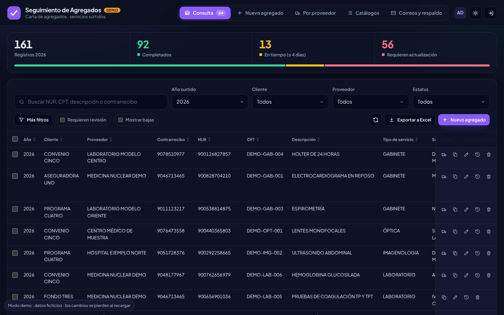
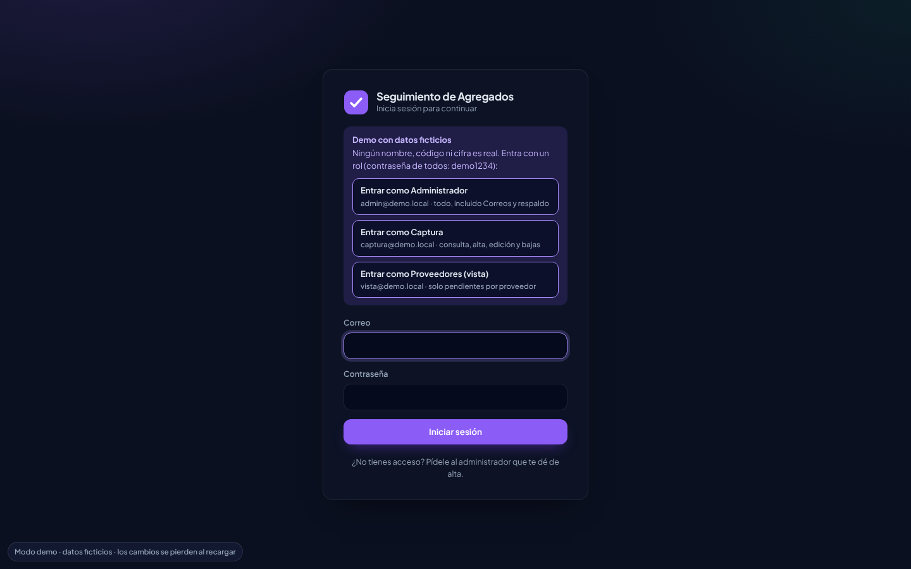
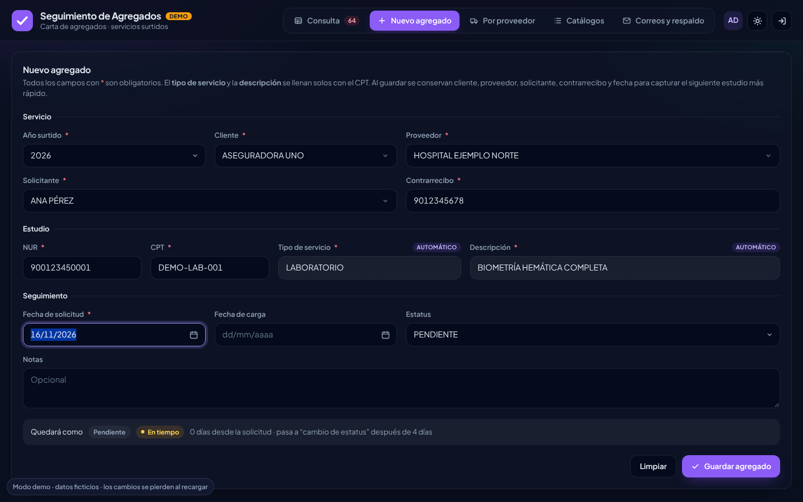
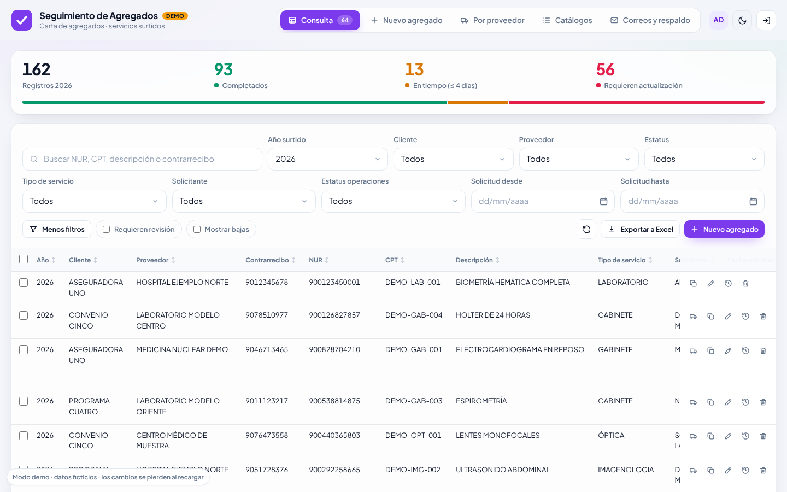
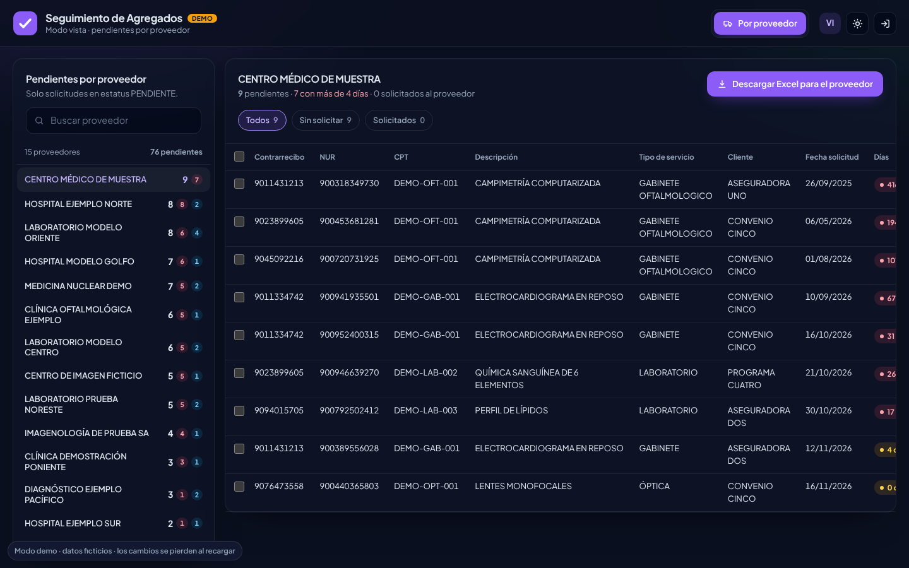
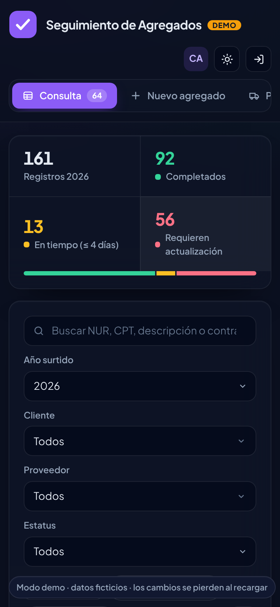
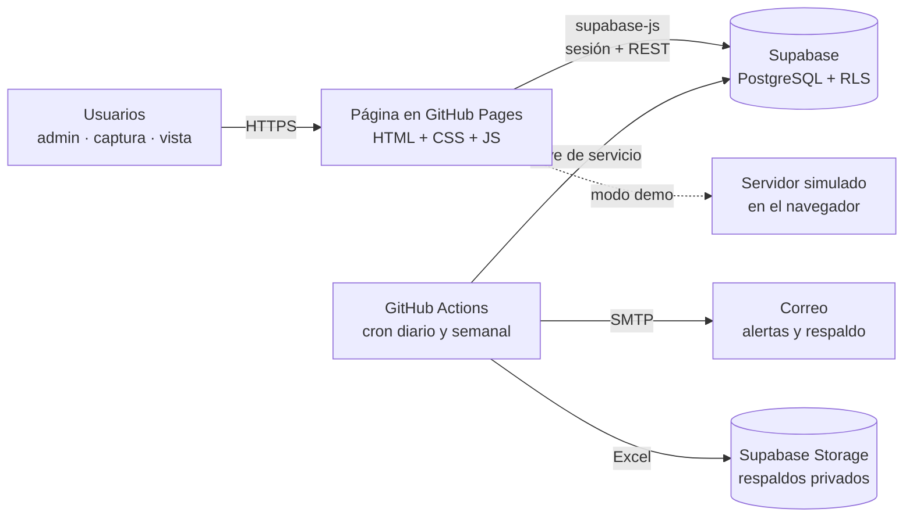
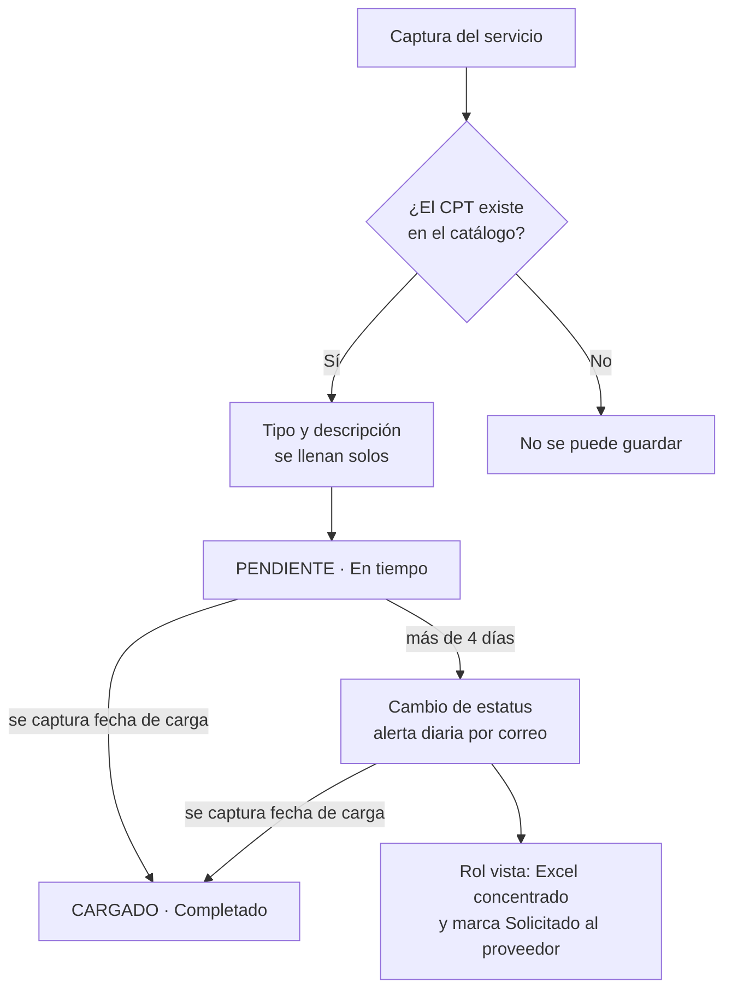
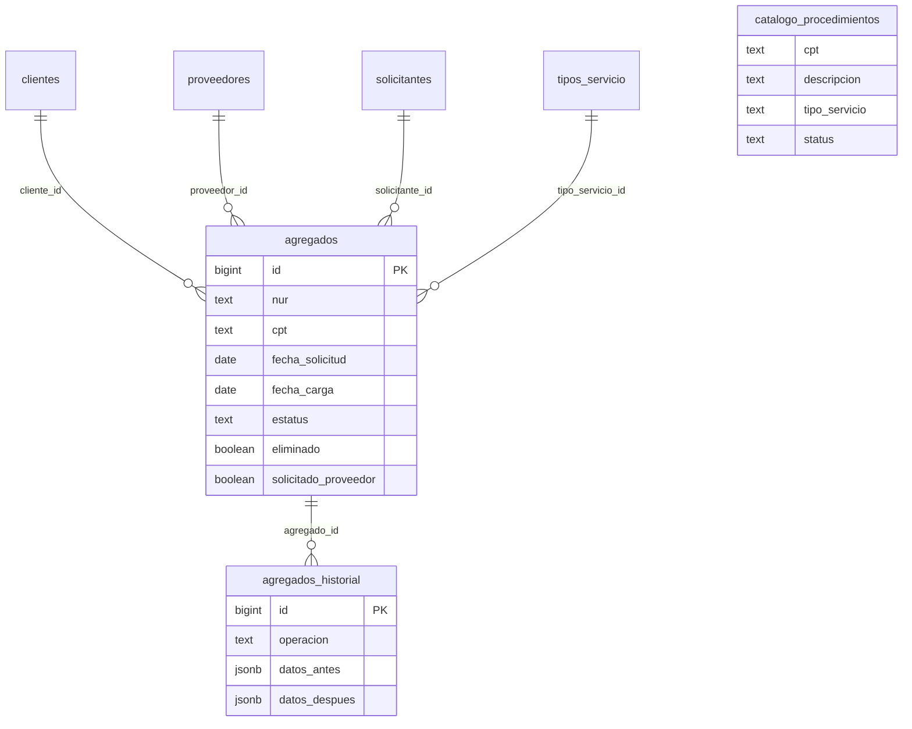

# Sistema de Seguimiento de Agregados

**Aplicación web que reemplazó una hoja de Excel compartida por un sistema con captura validada, semáforo de vencimientos, roles, historial de cambios y alertas automáticas por correo.**

[](https://guillermonavarreteher.github.io/sistema-seguimiento-agregados/)


-F7DF1E?logo=javascript&logoColor=black)


> La demo usa **datos 100 % ficticios** y un **servidor simulado dentro del navegador**: no se conecta a ninguna base real. Entra con un clic como *Administrador*, *Captura* o *Proveedores (vista)*.



---

## El problema

Un área operativa del sector salud llevaba el seguimiento de los servicios solicitados a proveedores en una **hoja de Excel compartida**. Eso causaba:

- Datos escritos a mano y sin validar: nombres con variantes, fechas mal capturadas y celdas vacías.
- Números de folio largos que **Excel convertía a notación científica**, con lo que se perdían dígitos.
- Ningún aviso cuando una solicitud llevaba días sin atenderse.
- Ningún registro de quién cambió qué, y ningún respaldo automático.

## La solución

Una aplicación web publicada en GitHub Pages, con base de datos en Supabase (PostgreSQL), que:

- **Migró la hoja original:** ~500 registros, con **0 diferencias** verificadas fila por fila contra el Excel. Se conservó una copia exacta inmodificable y se marcaron para revisión los registros con inconsistencias.
- **Valida en la captura:** listas cerradas en lugar de texto libre, fechas con calendario, campos obligatorios y folios guardados siempre como texto.
- **Llena tipo de servicio y descripción a partir del código del procedimiento** (CPT), usando un catálogo de **~32 mil procedimientos** que cubría el **100 % de los códigos en uso**.
- **Avisa por correo** cada día hábil de lo vencido y lo que está por vencer, y **respalda en Excel** cada viernes.
- **Separa permisos en 3 roles** (administrador, captura y vista), y la base de datos los hace cumplir aunque alguien intente saltarse la página.

## Funciones

| Función | Qué hace |
|---|---|
| Consulta con semáforo | Indicadores de completados, en tiempo (≤ 4 días) y por actualizar. Al dar clic filtran la tabla |
| Búsqueda y filtros | Por folio, código, descripción, cliente, proveedor, estatus, año y fechas; con orden y paginación del lado del servidor |
| Captura validada | Listas con buscador, autocompletado tipo Excel, máscara de fechas y aviso de folio repetido |
| CPT automático | El código llena tipo y descripción desde el catálogo; si hay dos opciones pide elegir, y si no existe no deja guardar |
| Fecha de carga en un clic | Al capturarla, el registro pasa solo a **CARGADO / COMPLETADO** |
| Bajas reversibles | Nada se borra: la baja exige motivo y se puede reactivar |
| Historial | Quién cambió qué y cuándo, con valor anterior y nuevo |
| Copiar para correo | Copia la selección como tabla que se pega con formato en Outlook o Excel |
| Pendientes por proveedor | Conteo por proveedor, **Excel concentrado** para enviarle y marca de "Solicitado al proveedor" |
| Exportar y respaldar | Excel con el formato original: una hoja por año, más bajas, registros en revisión y catálogos |
| Alertas automáticas | GitHub Actions envía cada día "vencidas" y "por vencer"; cada viernes, el respaldo |
| Modo claro / oscuro y móvil | Diseño adaptable, sin desbordes en pantallas de 390 px |

## Galería

| Inicio de sesión (demo) | Captura con CPT automático |
|---|---|
|  |  |
| **Modo claro** | **Pendientes por proveedor (rol vista)** |
|  |  |

<p align="center"></p>

## Tecnologías

| Capa | Tecnología | Por qué |
|---|---|---|
| Interfaz | HTML, CSS y JavaScript puro | Sin paso de compilación: se publica arrastrando archivos a GitHub |
| Datos | Supabase (PostgreSQL), Row Level Security, triggers y vistas | Las reglas de negocio y los permisos viven en la base, no solo en la pantalla |
| Archivos Excel | SheetJS | El mismo generador sirve para la página y para el respaldo automático |
| Automatización | GitHub Actions + Node.js + nodemailer | Alertas y respaldos programados sin servidor propio |
| Publicación | GitHub Pages | Gratis y con HTTPS |
| Pruebas | Node test runner, Playwright y PostgreSQL local | Unitarias, de extremo a extremo y de base de datos |

## Arquitectura



## Flujo principal



## Base de datos



Diccionario completo, funciones y políticas de seguridad: [docs/02-base-de-datos.md](docs/02-base-de-datos.md).

## Decisiones técnicas destacadas

- **La seguridad vive en la base.** Las políticas RLS, las funciones `es_admin()` y `es_vista()` y los triggers impiden escribir sin permiso, borrar registros o guardar una fecha de carga anterior a la solicitud, aunque alguien llame a la API directamente.
- **Demo con la misma aplicación.** La librería de Supabase acepta una función `fetch` propia. En modo demo, esa función responde desde un servidor simulado con las mismas reglas que la base. No hay código duplicado, y las pruebas verifican que **ninguna** petición salga a internet.
- **Datos ficticios deterministas.** Con la misma semilla salen los mismos bytes, y la huella está fijada en una prueba.
- **Folios como texto, siempre.** NUR y contrarrecibo se guardan y exportan como texto, para que Excel no vuelva a convertirlos a notación científica.
- **Excel idéntico en la página y en el respaldo.** Un solo generador lo usan la página y GitHub Actions.
- **Publicación sin fugas.** Un script construye esta versión a partir de la de producción y **falla** si reaparece un nombre real, una llave o un correo no permitido, incluso dentro de los archivos Excel.

## Mi participación

Desarrollé este sistema para el área donde trabajo, **con asistencia de IA (Claude, de Anthropic)**, y lo publico con autorización de la empresa. Para ser transparente:

- **Lo que hice yo:** detecté la necesidad; definí los requisitos y las reglas de negocio (listas cerradas, autocompletado como en Excel, semáforo de 4 días, año surtido, alertas, respaldos, roles, CPT automático, copiar para correo); proporcioné y depuré los datos; ejecuté la migración en Supabase; configuré GitHub Pages, los secretos y los usuarios; validé cada entrega con las personas que lo usan; pedí y probé cada mejora; preparé y limpié el catálogo de procedimientos; y coordiné la entrega del proyecto.
- **Lo que hizo la IA, bajo mi dirección:** escribió la mayor parte del código (página, SQL, automatizaciones), las pruebas y la documentación, y propuso soluciones técnicas que yo revisé y aprobé.

## Próximos pasos

- Pruebas automáticas de las automatizaciones de correo con un servidor SMTP simulado.
- Cambio de contraseña desde la página (hoy lo hace el administrador en Supabase).
- Actualizar SheetJS a una versión mantenida (ver [deuda técnica](docs/01-manual-tecnico.md#deuda-técnica)).
- Tablero de tiempos de atención por proveedor.

## Cómo ejecutarlo

**Ver la demo:** abre la [demo en vivo](https://guillermonavarreteher.github.io/sistema-seguimiento-agregados/) o, en tu computadora, abre `index.html` con cualquier servidor estático. Sin configuración, arranca en modo demo.

**Con tu propio Supabase:**
1. Corre en orden `sql/01` a `sql/04` (y `sql/05` si quieres datos de ejemplo) en el SQL Editor.
2. Copia `config.local.EJEMPLO.js` como `config.local.js` y pega tu URL y tu llave **anon**. Ese archivo nunca se sube.
3. Crea tus usuarios en Supabase → Authentication.

Detalle paso a paso en [docs/06-despliegue-y-mantenimiento.md](docs/06-despliegue-y-mantenimiento.md).

**Pruebas:**
```bash
npm install && npx playwright install chromium
npm test            # unitarias (11)
npm run test:e2e    # extremo a extremo en navegador real (20 pasos)
node pruebas/sql/probar-sql.mjs "postgres://usuario@localhost/base"   # SQL (21 comprobaciones)
```

## Documentación

| Documento | Contenido |
|---|---|
| [01 · Manual técnico](docs/01-manual-tecnico.md) | Arquitectura, código, funciones clave, cómo extenderlo y deuda técnica |
| [02 · Base de datos](docs/02-base-de-datos.md) | Diagrama ER, diccionario de datos, funciones y seguridad |
| [03 · Mapa de consultas](docs/03-mapa-de-consultas.md) | Qué consulta cada pantalla, parámetros y reglas de negocio |
| [04 · Manual de usuario](docs/04-manual-de-usuario.md) | Paso a paso con capturas |
| [05 · Pruebas](docs/05-pruebas.md) | Pruebas automáticas y casos manuales |
| [06 · Despliegue y mantenimiento](docs/06-despliegue-y-mantenimiento.md) | Instalación, publicación, versionado y solución de problemas |

---

<sub>Desarrollado por **Guillermo Navarrete** · [@GuillermoNavarreteHer](https://github.com/GuillermoNavarreteHer) · con asistencia de IA (Claude).
Proyecto de portafolio publicado con autorización. Todos los nombres, códigos, folios y cifras de la demo son ficticios; no representan a ninguna empresa, cliente, proveedor ni persona real. Bibliotecas de terceros y sus licencias en [TERCEROS.md](TERCEROS.md).</sub>
