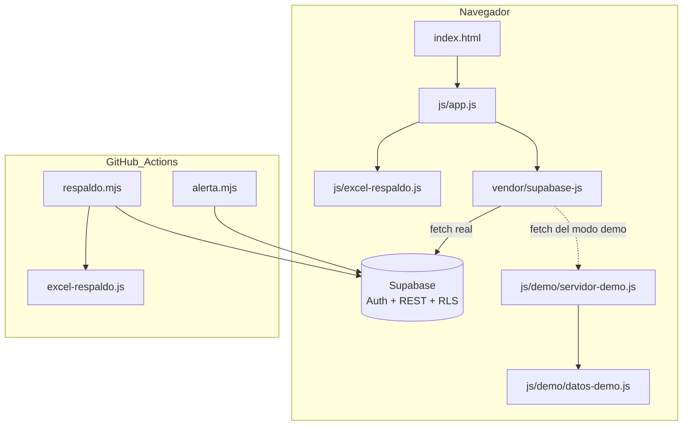

# 01 · Manual técnico

Autor: Guillermo Navarrete · [@GuillermoNavarreteHer](https://github.com/GuillermoNavarreteHer)

## Arquitectura

La página es un sitio estático (HTML, CSS y JavaScript sin frameworks ni compilación) que habla con Supabase mediante la librería `supabase-js`. Toda regla importante se repite en la base de datos (RLS, triggers, restricciones), así que la página nunca es la única barrera.

### Cómo decide si es demo

En `js/app.js`, la función `arrancar()` activa el **modo demo** cuando no existe `config.local.js` o cuando la dirección trae `?demo`. En ese caso crea el cliente de Supabase con `global.fetch = servidorDemo.fetch`. El resto de la aplicación no se entera: usa las mismas consultas, pantallas y reglas.

## Estructura del repositorio

| Ruta | Contenido |
|---|---|
| `index.html` | Estructura, íconos SVG y plantillas de formularios y ventanas |
| `css/styles.css` | Diseño con variables de color para modo claro y oscuro |
| `css/fonts.css` | Tipografía Plus Jakarta Sans incrustada |
| `js/app.js` | Toda la lógica de la página (≈2,300 líneas, comentadas por función) |
| `js/excel-respaldo.js` | Genera los Excel: respaldo, exportación y concentrado por proveedor |
| `js/demo/` | Modo demo: generador de datos, servidor simulado y avisos en pantalla |
| `vendor/` | supabase-js 2.45.4 y SheetJS 0.18.5 (copias locales, versión fija) |
| `config.local.EJEMPLO.js` | Plantilla de la configuración propia (`config.local.js` nunca se sube) |
| `sql/` | Scripts genéricos y repetibles, numerados del 01 al 99 |
| `automatizaciones/` | Scripts de alerta y respaldo, y workflows de ejemplo (no se ejecutan en este repositorio) |
| `herramientas/` | Construcción del portafolio, generadores de SQL y ejemplos |
| `pruebas/` | Unitarias, extremo a extremo y SQL |
| `docs/` | Esta documentación, capturas y archivos de ejemplo |

## Módulos de `js/app.js`

| Sección | Funciones clave |
|---|---|
| 1. Utilidades | `hoyISO()`, `dmyAISO()`, `estatusOps()`, `mensajeError()`, `toast()` |
| 2. Conexión y sesión | `arrancar()`, `alEntrar()`, `revisarAdmin()`, `revisarCatalogoCPT()` |
| 3. Catálogos en memoria | `cargarCatalogos()`, `altaCatalogo()`, `parecidos()` |
| 4. Componentes | `Combo()` (lista con buscador), `DateInput()` (máscara y calendario), `AutoExcel()` (autocompletado tipo Excel) |
| 4.4 Copiar para correo | `tablaCorreo()`, `alPortapapeles()` |
| 5. Formulario | `Formulario()`: alta y edición; `resolverCpt()` busca el CPT en el catálogo |
| 6. Consulta | `aplicarFiltros()`, `cargarTabla()`, `cargarKpis()`, `exportarConsulta()` |
| 7. Acciones por registro | `abrirCarga()`, `abrirEdicion()`, `abrirBaja()`, `reactivar()`, `abrirHistorial()` |
| 8–9. Catálogos y correos | `iniciarCatalogos()`, `iniciarCorreos()`, `descargarRespaldo()` |
| Por proveedor | `cargarListaProveedores()`, `cargarProveedor()`, `marcarSolicitado()` |
| 10. Navegación | `enrutar()`: rutas por `#hash` según el rol |

### Funciones clave explicadas

- **`estatusOps(fechaSolicitud, estatus, fechaCarga)`**: replica la fórmula de la hoja original. Devuelve COMPLETADO si está cargado, EN TIEMPO hasta 4 días naturales y CAMBIO DE ESTATUS OPERACIONES después.
- **`resolverCpt()`**: busca el código, sin distinguir mayúsculas, solo entre los **Habilitados**. Si hay una opción, la aplica; si hay varias, pide elegir; si no existe, usa un registro anterior con ese código o marca error. Si el tipo no existe en el catálogo de tipos, lo da de alta.
- **`traerTodo()`**: Supabase limita cada respuesta a 1,000 filas; esta función pide en bloques hasta traer todo (exportar y respaldar).
- **`alPortapapeles()`**: copia en HTML (tabla para Outlook) y en texto con tabuladores (Excel), con un método alterno si el navegador bloquea el portapapeles.

## Cómo extenderlo

| Quiero… | Dónde |
|---|---|
| Agregar una columna a la tabla | Columna en `sql/01`, campo en la vista de `sql/03`, entrada en `COLS` (sección 6 de `app.js`), y la misma columna en `filaVista()` de `js/demo/servidor-demo.js` |
| Cambiar el plazo de 4 días | `DIAS_LIMITE` en `app.js`, la vista `v_agregados` en `sql/03` y `filaVista()` en el servidor demo |
| Agregar un rol | Tabla de correos y función `es_<rol>()` en SQL, políticas en `sql/04`, `revisarAdmin()`/`prepararPestanas()` en `app.js` y `puedeEscribir()` en el servidor demo |
| Agregar un campo al Excel | `ENCABEZADOS` y `filaAgregado()` en `js/excel-respaldo.js` (se refleja en la página y en el respaldo) |

**Regla de oro:** toda regla nueva va en **tres** lugares: SQL, `app.js` y servidor demo. Las pruebas avisan si la demo se desalinea.

## Deuda técnica

| Tema | Detalle | Riesgo |
|---|---|---|
| SheetJS 0.18.5 | Tiene vulnerabilidades conocidas **al leer** archivos. El sistema solo **escribe** Excel; nunca abre archivos del usuario | Bajo |
| `app.js` grande | Un solo archivo de ≈2,300 líneas; conviene dividirlo en módulos ES | Mantenimiento |
| Contraseñas | No hay pantalla para que cada quien cambie la suya; lo hace el administrador en Supabase | Operativo |
| Automatizaciones sin prueba automática | `alerta.mjs` y `respaldo.mjs` se probaron a mano durante el desarrollo, pero no tienen prueba automatizada en este repositorio | Medio |
| `config.local.js` en la demo | La página lo busca siempre; en la demo responde 404 (esperado) y se ve en la consola | Cosmético |
| Fechas en dos lugares | El cálculo de días existe en la vista SQL, en `app.js` y en el servidor demo | Mantenimiento |
