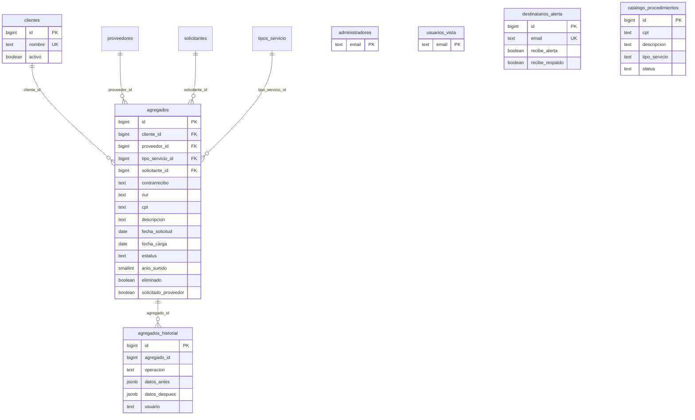

# 02 · Base de datos

Autor: Guillermo Navarrete · [@GuillermoNavarreteHer](https://github.com/GuillermoNavarreteHer)

PostgreSQL en Supabase. Los scripts de [`sql/`](../sql) son genéricos, comentados y se pueden repetir sin duplicar.

| Orden | Script | Contenido |
|---|---|---|
| 1 | `01_esquema.sql` | Tablas, restricciones e índices |
| 2 | `02_funciones_y_triggers.sql` | Reglas de negocio en la base |
| 3 | `03_vistas.sql` | Vistas que consulta la página |
| 4 | `04_seguridad.sql` | RLS, políticas y permisos |
| 5 | `05_datos_demo.sql` | Datos ficticios (opcional; generado) |
| 99 | `99_verificacion.sql` | Consultas de comprobación (solo lectura) |

## Diagrama entidad-relación

`proveedores`, `solicitantes` y `tipos_servicio` tienen la misma forma que `clientes`. `catalogo_procedimientos` es **independiente**: no tiene llave foránea, la página solo lo lee para llenar campos.

## Diccionario de datos: `agregados`

| Columna | Tipo | Regla |
|---|---|---|
| `id` | bigint | Identidad |
| `cliente_id`, `proveedor_id`, `solicitante_id`, `tipo_servicio_id` | bigint | Obligatorias; llave a su catálogo (`ON DELETE RESTRICT`) |
| `contrarrecibo` | text | Obligatorio en registros nuevos; solo dígitos (validado en la página) |
| `nur` | text | Folio; **texto** para no perder dígitos; se quitan espacios |
| `cpt` | text | Código del procedimiento |
| `descripcion` | text | Se llena desde el catálogo con el CPT |
| `fecha_solicitud` | date | Obligatoria; no futura (validado en la página) |
| `fecha_carga` | date | Opcional; **≥ fecha de solicitud** (`chk_fecha_carga_posterior`) |
| `estatus` | text | `PENDIENTE`, `CARGADO` o `ACLARACIÓN SERVICIO NO BRINDADO` |
| `notas` | text | Opcional |
| `anio_surtido` | smallint | Por defecto, el año en curso en hora de México |
| `origen` | text | `EXCEL_2026` (migrado, admite blancos) o `SISTEMA` |
| `fila_excel` | integer | Fila de la hoja original (solo migrados) |
| `requiere_revision`, `motivo_revision` | boolean, text | Inconsistencias detectadas al migrar |
| `eliminado`, `eliminado_en`, `eliminado_por`, `motivo_baja` | | Baja lógica; motivo obligatorio (`chk_baja_completa`) |
| `solicitado_proveedor`, `solicitado_en`, `solicitado_por` | | Marca del rol vista |
| `created_*`, `updated_*` | | Auditoría (correo tomado de la sesión) |

## Reglas que viven en la base

| Regla | Dónde |
|---|---|
| Fecha de carga ⇒ estatus CARGADO (y regresa a PENDIENTE si se borra) | Trigger `fn_agregados_before_write` |
| Limpieza de espacios, incluidos los espacios duros pegados desde Excel | Mismo trigger |
| Origen y fila del Excel inmutables | Mismo trigger |
| Historial de alta, cambio y baja | Trigger `fn_agregados_auditoria` → `agregados_historial` |
| Prohibido borrar agregados | Trigger `fn_bloquear_delete` |
| Sin blancos en registros nuevos | `chk_sin_blancos_registros_nuevos` |

## Vistas

| Vista | Uso |
|---|---|
| `v_agregados` | Todo con nombres de catálogo, `estatus_operaciones` y `dias_transcurridos` (hora de México) |
| `v_pendientes_vencidos` | No cargados con más de 4 días (alerta diaria) |
| `v_pendientes_por_proveedor` | Conteo de PENDIENTES por proveedor |
| `v_anios_surtido` | Años del desplegable (siempre incluye el actual) |

Todas usan `security_invoker = true`: respetan los permisos de quien consulta.

## Funciones

| Función | Devuelve | Para qué |
|---|---|---|
| `es_admin()` | boolean | ¿El correo de la sesión está en `administradores`? |
| `es_vista()` | boolean | ¿Está en `usuarios_vista`? |
| `marcar_solicitado(p_ids bigint[], p_valor boolean)` | integer | Marca o quita "Solicitado al proveedor"; regresa cuántos cambió. Única escritura del rol vista |

Las tres son `SECURITY DEFINER` con `SET search_path FROM CURRENT`: fijan su ruta al crearse, así nadie puede redirigirlas a otras tablas.

## Seguridad (RLS)

| Tabla | Sin sesión | Normal | Vista | Administrador |
|---|---|---|---|---|
| `agregados` | ✗ | Leer, alta, cambio | Solo leer | Leer, alta, cambio |
| Catálogos | ✗ | Leer, alta, cambio | Solo leer | Leer, alta, cambio |
| `agregados_historial` | ✗ | Leer | Leer | Leer |
| `catalogo_procedimientos` | ✗ | Leer | Leer | Leer |
| `destinatarios_alerta` | ✗ | (ve 0 filas) | (ve 0 filas) | Leer, alta, cambio, quitar |
| `administradores`, `usuarios_vista` | ✗ | ✗ (solo vía funciones) | ✗ | ✗ |
| Borrar agregados | ✗ | ✗ | ✗ | ✗ |

Las automatizaciones usan la llave de servicio (`service_role`), que salta RLS. Por eso esa llave solo vive en los secretos de GitHub Actions.
