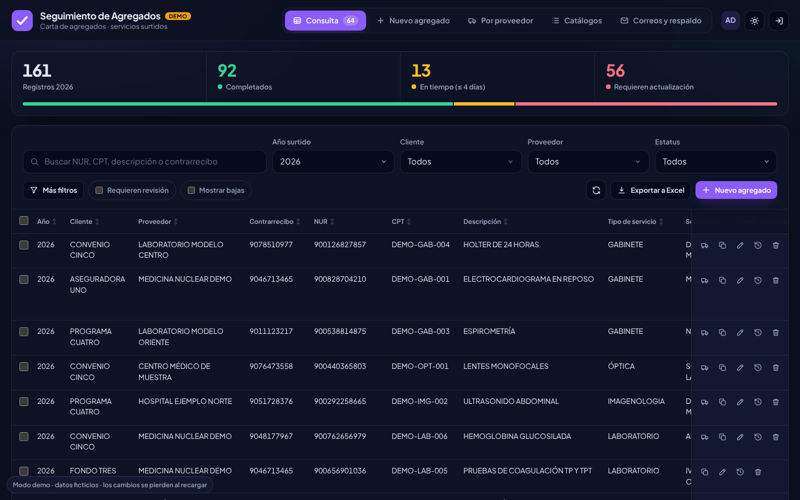
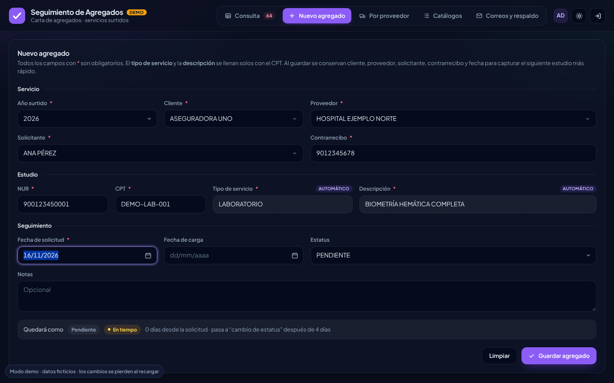
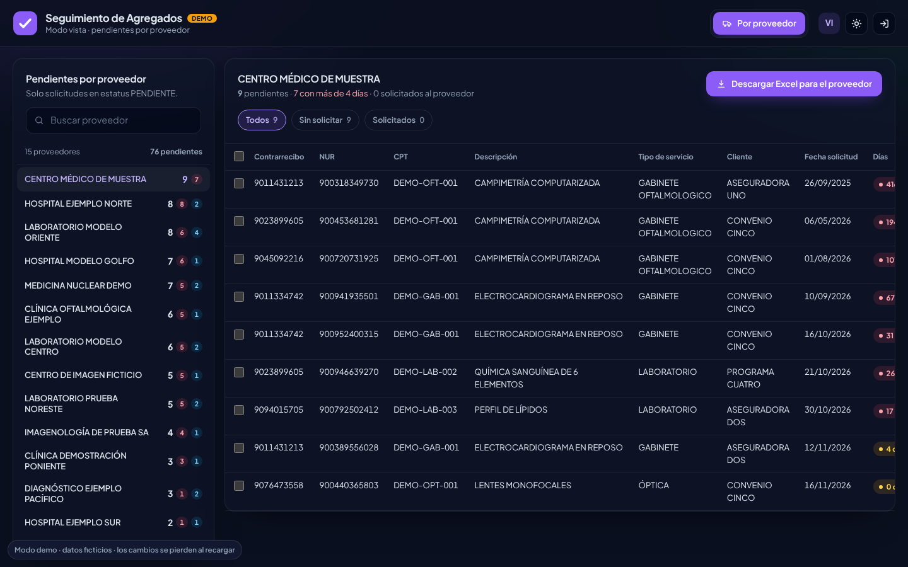
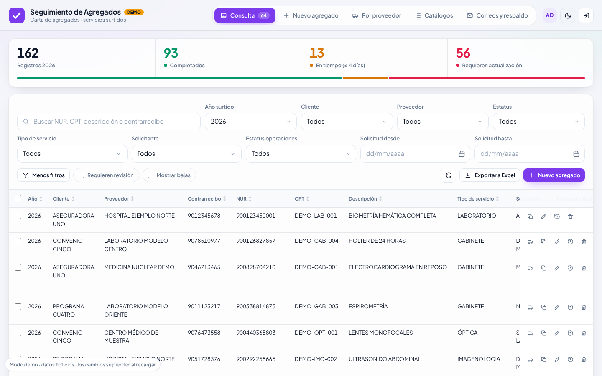

# 04 · Manual de usuario

Autor: Guillermo Navarrete · [@GuillermoNavarreteHer](https://github.com/GuillermoNavarreteHer)

Las capturas son de la **demo**: todos los datos son ficticios. Cada afirmación de este manual está contrastada con la demo en [05 · Pruebas](05-pruebas.md#contraste-manual-de-usuario--demo); la columna **M#** de esa tabla remite a los números de este documento.

## 1. Entrar

- **M1.** En la demo hay tres botones para entrar sin escribir contraseña: **Administrador**, **Captura** y **Proveedores (vista)**. La contraseña de los tres es `demo1234`.
- **M2.** Con un sistema real, entras con el correo y la contraseña que te dio el administrador.

| Rol | Pestañas que ve |
|---|---|
| Administrador | Consulta, Nuevo agregado, Por proveedor, Catálogos, Correos y respaldo |
| Captura | Consulta, Nuevo agregado, Por proveedor, Catálogos |
| Proveedores (vista) | Por proveedor |

- **M3.** Si escribes en la dirección una pestaña que tu rol no tiene, el sistema te regresa a la tuya.

## 2. Consulta

- **M4.** Arriba está el **semáforo**: registros del año = completados + en tiempo (≤ 4 días) + requieren actualización.
- **M5.** Al dar clic en un indicador, la tabla se filtra por ese estatus; otro clic quita el filtro.
- **M6.** El buscador encuentra por folio (NUR), código (CPT), descripción, contrarrecibo, proveedor o notas.
- **M7.** **Más filtros** agrega tipo de servicio, solicitante, estatus operaciones y rango de fechas. Dar clic en el título de una columna la ordena.

Iconos de cada renglón:

| Icono | Acción |
|---|---|
| Camión | Capturar fecha de carga |
| Dos hojas | Copiar para correo |
| Lápiz | Editar |
| Reloj | Historial |
| Bote | Dar de baja |
| Flecha | Reactivar (solo en bajas) |

- **M8.** **Fecha de carga** (camión): propone la fecha de hoy. Al guardar, el registro queda **Cargado / Completado**.
- **M9.** **Historial** (reloj): muestra el alta y cada cambio, con el correo de quien lo hizo.
- **M10.** **Dar de baja** (bote): exige motivo. El registro desaparece de la tabla, pero se ve con **Mostrar bajas** y se puede **reactivar**.
- **M11.** **Copiar para correo**: marca casillas (o usa el icono de un renglón) y pega con Ctrl + V en Outlook (sale como tabla) o en Excel (cada dato en su celda).
- **M12.** **Exportar a Excel** descarga exactamente lo que está filtrado.

## 3. Nuevo agregado

- **M13.** Cliente, proveedor y solicitante se **eligen de una lista con buscador**: escribe unas letras y presiona Enter.
- **M14.** Escribe el **CPT** y sal del campo: **tipo de servicio** y **descripción** se llenan solos y quedan bloqueados (etiqueta *AUTOMÁTICO*).
- **M15.** Si el código tiene **dos opciones** en el catálogo, aparecen botones para elegir la correcta.
- **M16.** Si el tipo del catálogo no existía en tu lista, el sistema **lo da de alta solo**.
- **M17.** Si el código está **deshabilitado** o **no existe**, no se puede guardar; el sistema dice cuántos datos faltan.
- **M18.** Al guardar aparece el aviso **"Agregado guardado"** y el registro se suma a **"Capturados en esta sesión"**, con su botón **Copiar tabla para correo**.
- **M19.** La fecha se escribe (dd/mm/aaaa; también acepta 5/3/26) o se elige en el calendario. No acepta fechas futuras.

Prueba en la demo con estos códigos ficticios: `DEMO-LAB-001` (normal), `DEMO-OPT-003` (dos opciones), `DEMO-ENF-001` (tipo nuevo), `DEMO-LAB-099` (deshabilitado).

## 4. Por proveedor

- **M20.** A la izquierda, cada proveedor con sus **pendientes** (número grande), los que llevan **más de 4 días** (rojo) y los ya **solicitados** (azul).
- **M21.** **Descargar Excel para el proveedor** baja el concentrado. Si no marcaste casillas, incluye todos sus pendientes.
- **M22.** Al descargar, el sistema pregunta si marcas esos registros como **Solicitado al proveedor**. Si aceptas, quedan marcados todos.
- **M23.** El rol **vista** solo tiene esta pantalla.

## 5. Catálogos y correos

- **M24.** **Catálogos:** alta, cambio de nombre y activar/desactivar. Nada se borra, y avisa si ya existe un nombre parecido.
- **M25.** **Correos y respaldo** (solo administrador): agregar destinatarios y elegir si reciben la alerta, el respaldo o ambos. Botón **Descargar respaldo ahora**.

## 6. Otros

- **M26.** El botón del sol / luna cambia entre **modo claro** y **oscuro**.

- **M27.** En el celular, la página se adapta sin desbordarse a lo ancho.
- **M28.** En la demo, los cambios **se pierden al recargar** la página: vuelve a empezar con los mismos datos ficticios.
